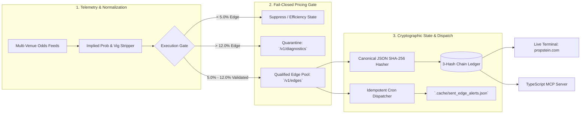

# PROPSTEIN

**Deterministic Quantitative Pricing Engine, Cryptographic Receipt Ledger, and Event-Driven Market State Terminal.**

[](https://propstein.com)
[](#verification--test-suite)
[](#verification--test-suite)
[](#model-context-protocol-mcp-interface)

Retail analytics platforms rely on unverifiable post-hoc win rates, unquarantined outlier feeds, and mutable database records. **PropStein** (formerly PropWire) is a fail-closed quantitative market pricing engine and real-time analytics terminal engineered with institutional fintech rigor.

The platform ingests multi-book order book and player proposition telemetry, normalizes implied probability distributions, quarantines statistical anomalies (`>12.0%` synthetic divergence), and commits pre-settlement pricing snapshots to a **3-hash SHA-256 verification chain** over canonical JSON (sorted keys).

---

## System Architecture



---

## Core Engineering Primitives

### 1. Segregated Execution vs. Diagnostic Pipelines (`/v1/edges` vs. `/v1/diagnostics`)
- `executionGate.ts` and the Python quantitative pipeline enforce strict numeric bounds. Edges exceeding 12.0% expected value are automatically flagged as stale-line or feed anomalies and routed to `/v1/diagnostics` rather than polluting live production execution boards.
- When market spreads tighten efficiently, the terminal enters a deterministic **Zero-Play Market Efficiency State** rather than fabricating low-edge volume.

### 2. 3-Hash Cryptographic Verification Chain (`POST /api/v1/verify-receipt`)
Every published edge is anchored across three verifiable lifecycle states serialized as canonical JSON (`crypto_utils.py`):
1. **`opening_recommendation_hash`**: Timestamped model projection, fair odds, and book price at discovery.
2. **`closing_snapshot_hash`**: Automated pre-kickoff closing line snapshot (`closing_snapshots` SQL table) capturing true Closing Line Value (CLV).
3. **`settlement_resolution_hash`**: Automated boxscore ingestion (ESPN/Sleeper telemetry) joined against the prior two hashes to produce a tamper-evident audit receipt.

### 3. Idempotent Event-Driven Alert Dispatcher
- Automated GitHub Actions cron workflow (`scripts/dispatch_edge_alerts.py`) evaluates live market boards on schedule.
- Maintains deterministic state deduplication via SHA-256 payload fingerprints stored in `.cache/sent_edge_alerts.json`, guaranteeing zero duplicate webhook emissions across stateless runner restarts.

### 4. Model Context Protocol (MCP) Server Integration
- Exposes a native TypeScript `@modelcontextprotocol/sdk` server allowing autonomous quantitative agents to query live edges, validate multi-leg correlation slips, and cryptographically inspect historical receipts.

---

## Technical Stack

| Layer | Technology | Role & Design Constraint |
| :--- | :--- | :--- |
| **Quantitative Engine** | Python 3.12, FastAPI, Pytest | Statistical distribution modeling, vig removal, canonical JSON hashing |
| **State & Persistence** | PostgreSQL / SQLite, `.cache` JSON | `closing_snapshots` ledger, idempotent alert deduplication |
| **Terminal UI** | Vanilla ES6+ / Next.js, Tailwind | Zero-bloat `#0B0D11` slate canvas, 1px `#222733` hairlines, sub-16ms table renders |
| **Agent Interface** | TypeScript, `@modelcontextprotocol/sdk` | Structured tool definitions (`get_current_edges`, `verify_slip`, `inspect_diagnostics`) |
| **CI/CD & Automation** | GitHub Actions, Vercel Edge | Automated cron ingestion, persistent state caching, strict CSP/SSL headers |

---

## Model Context Protocol (MCP) Interface

Connect Claude Desktop, Cursor, or custom autonomous agents directly to the PropStein pricing engine:

```json
{
  "mcpServers": {
    "propstein-quant": {
      "command": "node",
      "args": ["./mcp-server/dist/index.js"],
      "env": {
        "PROPSTEIN_API_URL": "https://propstein.com/api/v1",
        "PROPSTEIN_QUANT_KEY": "QUANT-XXXX-XXXX"
      }
    }
  }
}
```

### Exposed MCP Tools

- **`get_current_edges`**: Retrieves fail-closed validated edges (5.0% ≤ EV ≤ 12.0%) with embedded SHA-256 opening receipts.
- **`verify_slip`**: Evaluates multi-leg DFS Pick'em (PrizePicks 5-Flex / 2-Power, Underdog 3-Pick) and SGP correlation matrices against breakeven implied probability thresholds.
- **`inspect_diagnostics`**: Queries quarantined feed anomalies (>12.0% divergence) and stale-market flags for quantitative debugging.

---

## Verification & Test Suite

PropStein enforces strict contract validation prior to every production deployment:

```bash
# 1. Run Python Quantitative & Cryptographic Contract Suite (118 tests)
pytest -q
# -> Tests canonical JSON hashing, float-precision boundary gates, and CLV SQL joins

# 2. Dry-Run the Idempotent Edge Alert Dispatcher
python3 scripts/dispatch_edge_alerts.py --dry-run --min-edge 5.0
# -> Evaluates live payload, checks .cache/sent_edge_alerts.json SHA-256 state, outputs qualified edges

# 3. Execute End-to-End Production Readiness Checks (286 assertions)
npm run verify:prod
# -> Validates CSP headers, executionGate.ts precision bounds, and mode-sync state machines
```

---

## Cryptographic Receipt Verification Example

Verify any historical projection against its pre-game closing snapshot and final settlement:

```bash
curl -s -X POST https://propstein.com/api/v1/verify-receipt \
  -H "Content-Type: application/json" \
  -d '{"receipt_id": "ps_rcpt_8f92a1c4"}' | jq .
```

```json
{
  "status": "VERIFIED",
  "canonical_form": "canonical JSON (sorted keys)",
  "chain": {
    "opening_hash": "4a7d1ed414474e4033ac29ccb8653d9b4b0e8ef12c6f6630f9d9f58992160911",
    "closing_snapshot_hash": "9c1185a5c5e9fc54612808977ee8f548d88e0ec08d17a3a9fb379c381c81ef8",
    "settlement_hash": "d7a8fbb307d7809469ca9abcb0082e4f0dc50df3650d03227a9228811d0be64e"
  },
  "metrics": {
    "published_fair_prob": 0.584,
    "closing_implied_prob": 0.569,
    "clv_delta_bps": "+150 bps",
    "anomaly_quarantined": false
  }
}
```

---

## License

Proprietary / All Rights Reserved © [Nick Altstein](https://github.com/NickAltstein) — Live Terminal: [propstein.com](https://propstein.com)
